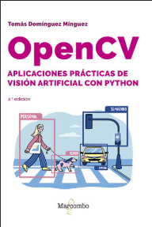
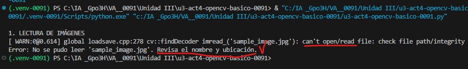
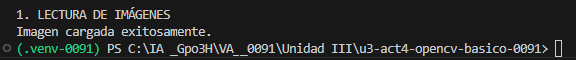
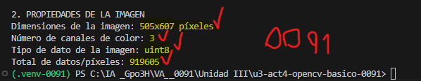
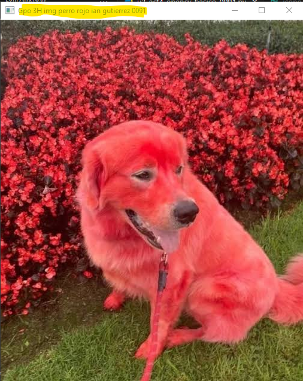
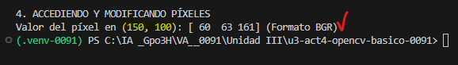
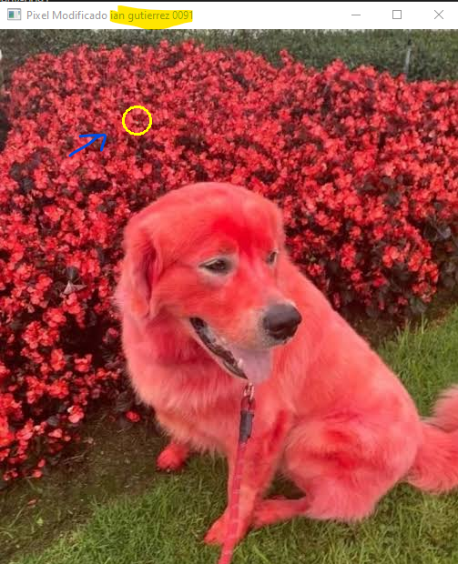

## operaciones basicas con open cv
## alumno Ian gutierrez NC 0091

# 1. LECTURA DE LA IMAGEN DESDE LA CARPETA
### cuando no pudo cargar la imagen

### cuando si pudo cargar la imagen

# 2. PROPIEDADES DE LA IMAGEN

## mostrando imagen original 

## nueva terminal

# 4. ACCESO Y MODIFICACIÓN DE PÍXELES INDIVIDUALES
